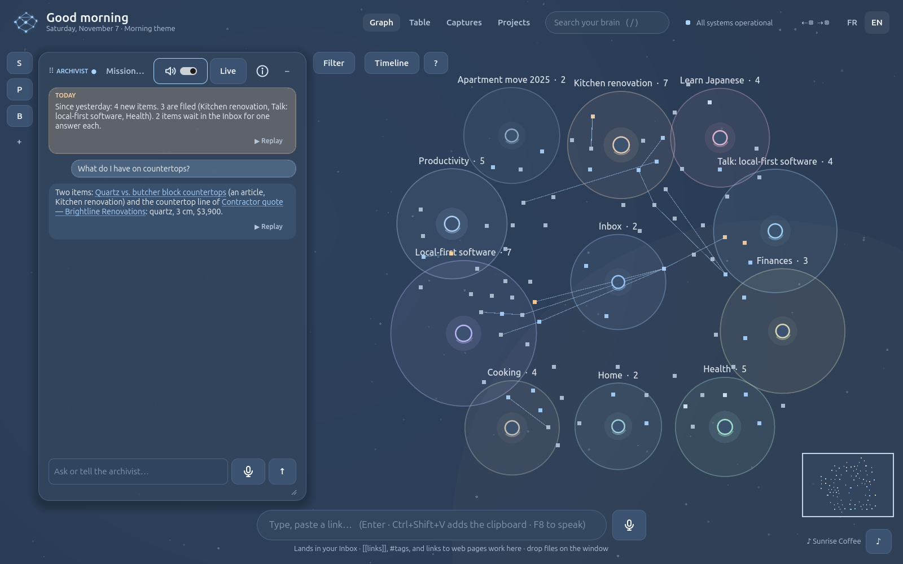
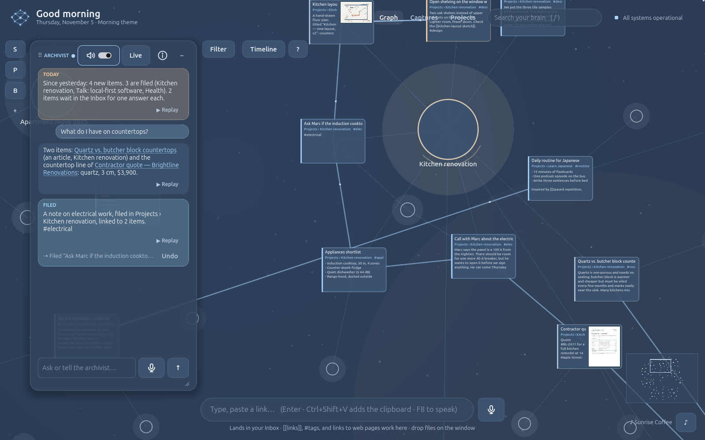
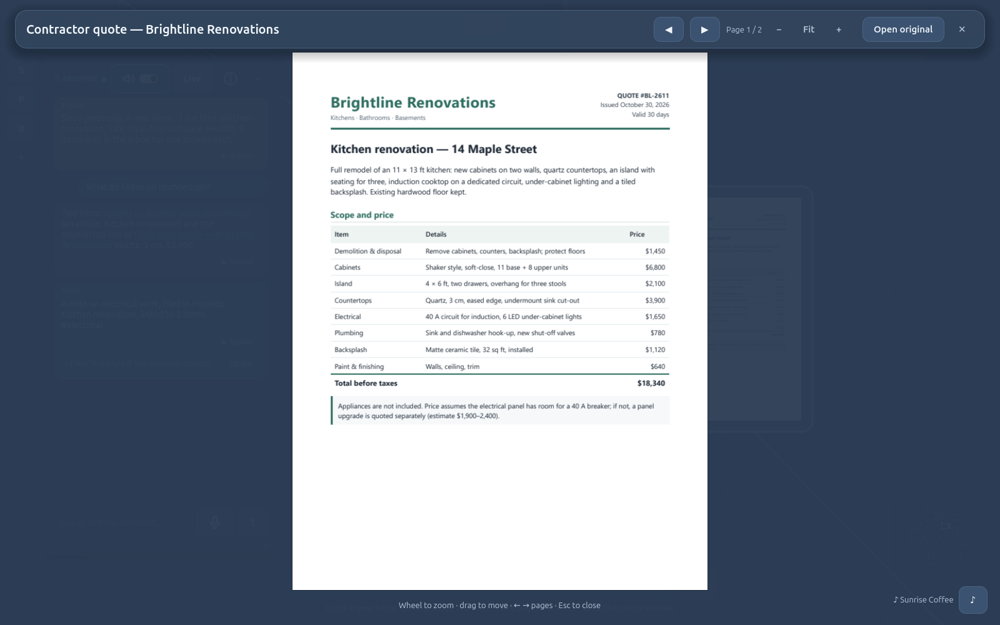
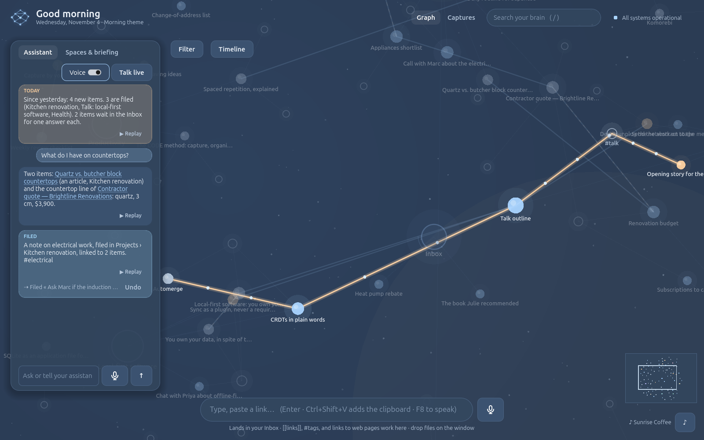

# Second Brain GD

**Your knowledge. Your system. Your control.**

Second Brain GD is a local-first second brain you can talk to. Give it anything (a thought, a link, a PDF, a
scanned letter, a picture, a web page from your browser, your voice): an archivist files it with the CODE method
and PARA, links it by meaning to what you already know, and you explore it all in a living graph you can zoom into
until the text is there. Agents think with you (Sparring) or are made to measure by an Agent Builder that interviews
you. Godot is the interface, a local Python engine does the work, and your Brain stays in a folder on your computer.
It also opens to your other AI tools, on your terms: Claude Code can read it and propose (the archivist decides), and
your agents can use the MCP servers you connect.



| Zoom in: items become cards | Your PDFs, page by page | How is X connected to Y? |
|---|---|---|
|  |  |  |

## Get it

**The package (Windows, Linux):** unzip `SecondBrainGD-windows.zip` (or `-linux`) anywhere, run `SecondBrainGD.exe`
(`SecondBrainGD.x86_64`), press **Setup**. It brings its own Python with everything installed: no Python to
install, no administrator rights, setup takes a few seconds. Check the download against its `SHA256SUMS`.

**From the source (developers):** Godot 4.7 (standard build), Python 3.12 or 3.13, Git. Clone, open `project.godot`
in Godot, press **Run**, then **Setup**: it creates a private virtual environment and installs 15 hash-locked
packages. Details: [`public/docs.html#install`](public/docs.html).

**Your OpenAI key** (optional, asked after setup, stored in the Windows Credential Manager or a private file):
filing, summaries, meaning search, voice, image descriptions. Without it the app still captures, shows and
searches by words. You pay OpenAI directly for what you use; the engine room shows the real costs.

**English or French:** the FR / EN switch at the top right.

## What stays where
| What | Where (Windows) |
|---|---|
| Your Brain (database, kept files, logs) | `%LOCALAPPDATA%\SecondBrainGD` (Linux: `~/.local/share/second-brain-gd`) |
| Backups | chosen in the engine room, **Your data** (until then `...\backups`) |
| Your API keys | Windows Credential Manager (Linux: a private file in the data folder) |

Nothing leaves your computer except what you send to OpenAI, the web pages the agents fetch when Internet is on,
and what goes to the MCP servers you choose to connect. Backups, restore, start fresh and uninstall: the engine room, **Your data**
([docs](public/docs.html#backups)).

## Documentation
- **[Docs](public/docs.html)**: install, the archivist, the graph, voice commands, agents, missions, imports,
  voice memos, recipes and the table, printing, MCP, packs, backups, local API, troubleshooting.
- **[How-to](public/howto.html)**: step-by-step guides captured from the real app.
- [Guide: connect Claude Code (MCP)](docs/guide-mcp.md) · [plans](docs/plans/README.md) ·
  [architecture](docs/architecture/overview.md)
- [CONTRIBUTING.md](CONTRIBUTING.md) · [THIRD_PARTY_NOTICES.md](THIRD_PARTY_NOTICES.md) ·
  [audit before going public](docs/audit-before-public.md)

**Status:** in active development (see [STATUS](STATUS.md)). The repository is private for now; its licence is not
chosen yet.

## Using it

- **Capture:** type in the bottom bar and press Enter (Ctrl+Space focuses it). `[[Another note]]` links,
  `#tag` groups.
- **Explore:** use the wheel to zoom, drag to pan. Drag an item into another place's zone to move it there;
  dropped elsewhere it stays put. Click a note to edit it, a space to filter, a tag to search. Press `/` to
  search and Esc to close.
- **Two agents:** the *Archivist* keeps the graph (files, moves, links, finds); *Sparring* is a thinking partner for long
  spoken sessions (F9): it questions, challenges or reassures, never changes the Brain, and saves a synthesis only when
  you approve it. Each has its own floating panel; F8/F9 talk to the one you last used.
- **Your own agents:** click **+** on the rail; the *Agent Builder* interviews you and writes the instructions, shows
  the draft, and creates the agent on your yes. Each agent is a profile (instructions, capabilities, model): ⓘ shows it.
- **Browser:** the Edge/Chrome extension in `browser-extension/` sends the page you read (as you see it) in one
  click, and lets the assistant open, add (« injecte-la ») and close tabs by voice. Install: `edge://extensions` →
  Developer mode → Load unpacked; pair it from *Captures → Send from browser…*. Guide:
  [`public/docs.html#extension`](public/docs.html#extension).
- **Internet:** « cherche sur internet … » searches the web (through OpenAI) and answers with its sources as links.
- **Files:** drop PDFs, Word, HTML, text or images on the window. Originals are kept. A scanned PDF (pages
  that are pictures) is read by the **local OCR**: built into Windows, Tesseract on Linux
  (`sudo apt install tesseract-ocr tesseract-ocr-fra`). Nothing leaves your machine; *Re-read with AI* in the
  viewer is optional. Details and dependencies: [`public/docs.html#files`](public/docs.html#files).
- **Ambiance:** the ♪ button at the bottom right sets the theme (Auto, Morning, Focus, Evening, Forest), music,
  effects and ambience.
- **Voice:** click the microphone (Ctrl+M), speak, click again. It needs your own OpenAI API key, asked once
  after setup or on first use. The key is stored in your system's credential store.
- **Assistant:** the left panel. She briefs you at the first opening of the day, answers from your notes
  (click a cited note to open it), and saves or moves notes when you ask. Everything she changes has an
  Undo. Toggle *Voice* to hear her, or use her mic to talk to her.
- **Imports:** drop a folder or a `.zip` of notes (Obsidian, Logseq, Notion export, Markdown): a preview, then a
  layer you can switch off. Drop a **voice memo** (m4a, mp3, wav): it is transcribed and cut into ideas and tasks.
- **Table:** the Table tab shows items in rows and columns; tick recipes and « Grocery list » adds their ingredients
  up by aisle; « PDF » prints them on Letter paper.
- **MCP:** the ⇠● ⇢● lights at the top: connect Claude Code to read your Brain (it proposes, the archivist
  decides, the timeline can undo), and give your agents MCP servers (any server from a catalogue or the official registry, keys,
  sign-ins, local programs with your approval). Guide: [docs/guide-mcp.md](docs/guide-mcp.md).
- **Engine room:** click "All systems operational" at the top right.

## Audio assets

Generated once and committed, so users never need an API key. To regenerate, edit `tools/audio-prompts.txt`,
then run:

```bash
./tools/audio.sh              # only missing files
./tools/audio.sh music/focus_2 # one file again
```

The ElevenLabs key comes from the encrypted `.env` via dotenvx (`dotenvx set ELEVENLABS_API_KEY ...`).
`.env.keys` is never committed.

## Voice benchmark (developers)

```bash
# once: add the key to the encrypted .env without showing it
read -rsp "OpenAI key: " K && echo && ~/.local/bin/dotenvx set OPENAI_API_KEY "$K" && unset K
./tools/voice-bench.sh --models gpt-realtime-whisper,gpt-live-transcribe
```

## Command line (optional)

The bootstrap runs without Godot too:

```powershell
python engine\bootstrap.py detect     # is this Python compatible?
python engine\bootstrap.py setup      # install / repair, then start the API
python engine\bootstrap.py status     # show install_state.json
python engine\bootstrap.py stop       # stop the API
```

With the Microsoft Store Python, create the data folder first (`mkdir %LOCALAPPDATA%\SecondBrainGD`);
see [troubleshooting](docs/troubleshooting.md#microsoft-store-python).

## Tests

```powershell
.\tools\test.ps1                                                  # Python tests
.\tools\test.ps1 -Godot C:\path\Godot_v4.7.2-stable_win64_console.exe   # + Godot end-to-end
```

On Linux or WSL: `./tools/test.sh` (set `GODOT=` if `godot` is not on PATH).
The Python tests create a real virtual environment and start the real API in a temporary folder.
The Godot test presses the real Setup button headless and checks the System Console values.

## Repository layout

```
scenes/        Godot screens (startup/, brain/, dashboard/) and UI components
scripts/       GDScript: core/ (app, theme, paths), setup/ (Python locator, bootstrap runner), monitoring/ (API client)
engine/        Python: bootstrap.py, installer/, database/ (+ migrations), api/, brain/ (knowledge, archivist, types,
               table, export, timeline), sources/ (intake, imports, voice memos, recipes), assistant/, voice/,
               mcp/ (server, client, catalogue, OAuth, local servers, WSL relay), browser/, agents/
browser-extension/  the Edge/Chrome extension (Manifest V3): pairing, send page/selection, voice open/add/close
tests/         python/ (unittest), godot/ (headless end-to-end)
public/        landing page and docs (open public/index.html or public/docs.html, no build)
docs/          architecture/, plans/, guide-mcp.md, troubleshooting, screenshots
tools/         test.sh, test.ps1, showcase.sh / howto.sh (screenshots on a private virtual display),
               package/ (the packages with their own Python), i18n.py (the French translations),
               web_images.gd (PNG → WebP for the site)
i18n/          fr.json: every interface text, English → French
```

## Architecture notes

- [Architecture overview](docs/architecture/overview.md)
- [Event protocol (Python → Godot)](docs/architecture/events-protocol.md)
- [Process lifecycle](docs/architecture/process-lifecycle.md)
- [Knowledge model, Whisper and agents plan](docs/architecture/knowledge-model.md)
- [Backups](docs/architecture/backups.md) · [Brain packs](docs/architecture/packs.md)
- [MCP: server and client](docs/architecture/mcp.md) · [Typed items, table, export](docs/architecture/typed-items.md)
- [Troubleshooting](docs/troubleshooting.md)
- [STATUS](STATUS.md) · [BACKLOG](BACKLOG.md) · [DEVLOG](DEVLOG.md)
